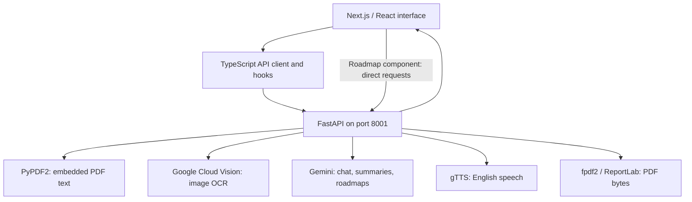

# digital-literacy

**An AI-assisted learning prototype for digital skills, document study, and guided exploration.**

digital-literacy combines a Next.js interface with a FastAPI backend. Its core learning tools are an AI tutor, a NoteBot that extracts and summarizes uploaded material, and a topic-based roadmap generator. The project is oriented toward digital-literacy education for rural Indian learners, with simple-language tutoring prompts and a responsive interface.

The repository also contains sample learning paths, a demonstration dashboard, and an authentication mockup. These illustrate the intended experience; they are not connected to real accounts, stored learning progress, or an adaptive learning engine.

> **Project status:** development prototype. AI features require external Google services and suitable credentials. Several integration gaps remain, including PDF request formats, image fallback handling, and Windows launch scripts. This README distinguishes implemented behavior from intended features; see [Known limitations](#known-limitations).

## Contents

- [Capabilities and boundaries](#capabilities-and-boundaries)
- [Architecture](#architecture)
- [Quick start](#quick-start)
- [Configuration](#configuration)
- [Learning workflows](#learning-workflows)
- [API reference](#api-reference)
- [Repository map](#repository-map)
- [Development and verification](#development-and-verification)
- [Known limitations](#known-limitations)
- [Troubleshooting](#troubleshooting)
- [License](#license)

## Capabilities and boundaries

| Area | What is implemented |
| --- | --- |
| AI tutor | Sends a message and optional context to Gemini and displays the response. The tutor prompt asks for simple explanations and permits English/Hindi responses. |
| NoteBot extraction | Accepts PDF, PNG, and JPEG uploads. PDFs use embedded-text extraction; images try Cloud Vision and then a Gemini fallback path. |
| Study material | Requests OCR correction, Markdown summaries, summary points, and revision questions. |
| Notes chat | Sends a question with the extracted notes and asks Gemini to answer from that context. |
| Audio | Rephrases summary text through Gemini, then requests English MP3 audio through gTTS. |
| Roadmaps | Generates a Markdown learning plan from a topic. |
| PDF helpers | Includes fpdf2 summary generation and ReportLab roadmap rendering; browser/API integration has limitations described below. |
| Learning paths and dashboard | Static example modules, learner statistics, achievements, and progress displays. |
| Authentication screen | Simulated delay followed by navigation; no identity verification, sessions, or account database. |

There is no offline model, persistence layer, production authentication, or verified multilingual curriculum. Interface claims about learner counts, partnerships, language coverage, or outcomes should be treated as demonstration copy, not measured project results.

## Architecture



| Layer | Technology / responsibility |
| --- | --- |
| Web application | Next.js 15.2.4 App Router, React 19, TypeScript |
| UI | Tailwind CSS 4, Radix-based components, Lucide icons, React Markdown |
| API | FastAPI, Pydantic, Uvicorn, multipart uploads |
| AI generation | `google-generativeai` SDK; roadmap generation uses a separate REST request |
| Extraction | Google Cloud Vision, Pillow, PyPDF2 |
| Output | fpdf2, ReportLab, gTTS |
| Dependency management | `pnpm-lock.yaml` for the frontend; minimum-version Python requirements |

[`lib/api/backend.ts`](lib/api/backend.ts) centralizes most backend requests, and [`hooks/use-ai-backend.ts`](hooks/use-ai-backend.ts) supplies loading/error state to the UI. [`components/roadmap-generator.tsx`](components/roadmap-generator.tsx) currently makes separate requests to a hardcoded localhost address.

The frontend and backend are separate processes and origins. A single browser entry point does not mean the backend is reverse-proxied through Next.js. There is no database or server-side document history in the application.

## Quick start

Use **Python 3.11+**, **Node.js 20+**, and **pnpm 9+** as a setup baseline. The project does not declare a complete supported-runtime matrix; the lockfile uses pnpm's version 9 format. AI requests require a Gemini key and access to the configured models.

### 1. Clone and prepare configuration

```bash
git clone https://github.com/quixoticalcoder/digital-literacy.git
cd digital-literacy
cp .env.example .env.local
cp backend/.env.example backend/.env
```

Set your Gemini key in `backend/.env`. Add Cloud Vision credentials there if image OCR through Vision is needed. Keep secrets out of browser-facing `NEXT_PUBLIC_*` variables.

### 2. Start the backend

Run these commands from the repository root:

```bash
python3 -m venv .venv
source .venv/bin/activate
python -m pip install -r backend/requirements.txt
python -m uvicorn backend.main:app --reload --host 127.0.0.1 --port 8001
```

On Windows PowerShell, use `py -3.11 -m venv .venv` and `.\.venv\Scripts\Activate.ps1`; use `Copy-Item` instead of `cp` if preferred.

The module path **`backend.main:app` matters**: `main.py` uses relative imports for PDF and roadmap helpers. Starting `main:app` from inside `backend/` can fail with an import error.

### 3. Start the frontend

In another terminal at the repository root:

```bash
pnpm install --frozen-lockfile
pnpm dev
```

Open the URL printed by Next.js, normally [http://localhost:3000](http://localhost:3000). The example frontend configuration points API requests to `http://localhost:8001`.

### 4. Check the API

```bash
curl http://localhost:8001/health
```

Explore [Swagger UI](http://localhost:8001/docs) or [ReDoc](http://localhost:8001/redoc) for the registered routes and exact request schemas. Health reports configuration flags; it does not call the model provider to verify credentials, quota, or model availability.

Use the manual commands above as the primary setup path. The bundled `.bat` launchers and `app.py` have Windows, port, and import-path assumptions; they are not a reliable cross-platform one-click installer. Details are in [README_AI_SETUP.md](README_AI_SETUP.md).

## Configuration

| Variable | Where to set it | Behavior |
| --- | --- | --- |
| `GEMINI_API_KEY` | `backend/.env` | Gemini credential used by chat, summaries, and roadmaps. The extraction route currently requires it even for PDF text extraction and Vision OCR. |
| `GOOGLE_APPLICATION_CREDENTIALS` | `backend/.env`, optional | Absolute path to a local Cloud Vision service-account JSON file. The client also attempts Google's default credential discovery. |
| `NEXT_PUBLIC_API_URL` | Root `.env.local` | Shared browser API client base URL; defaults to `http://localhost:8001`. Restart Next.js after changing it. |
| `HOST` / `PORT` | Backend environment | Read by the `__main__` block, not by the explicit Uvicorn CLI command above. CLI host/port flags control that command. |

Backend configuration is loaded with `python-dotenv`. Store credentials outside source control; the supplied examples contain placeholders. If both root and backend `.env` files exist, keep backend settings unambiguous because dotenv discovery searches relative to the loading module.

Most generation paths hardcode `gemini-2.0-flash-thinking-exp`; the roadmap helper calls `gemini-1.5-pro` through a REST URL. These are repository-configured IDs, not a verified current model catalog. There is no model environment setting or automatic model migration. Check provider availability and update the relevant source before relying on live generation.

The default CORS list permits selected local origins on ports 3000–3003 and 8001–8002. Remote hosting requires corresponding API URL and CORS changes; the roadmap component also needs its hardcoded URL addressed.

## Learning workflows

### Tutor

1. Open `/tutor` and enter a question.
2. The client sends `message` and a teaching `context` to `/chat`.
3. The backend submits the prompt to Gemini and returns a response envelope.

The context asks for patient, simple explanations with practical examples. Responses are ordinary request/response results, not token-streamed output. The server does not maintain a persistent conversation or student profile.

### NoteBot

1. Upload a PDF, PNG, or JPEG at `/notebot`.
2. `/ocr/extract` reads the upload into memory and identifies PDF or image data.
3. PDFs use PyPDF2 to extract existing text. Scanned PDFs without a text layer are not automatically OCRed page by page.
4. Images try Cloud Vision when its client exists; a separate Gemini path is intended as fallback, but currently has an `io` scoping defect.
5. The browser passes extracted text and filename in the `/notebot/results` URL query string.
6. The results page requests enhanced notes, additional summaries, revision questions, contextual answers, and optional audio.

“Answer only from the notes” is a prompt instruction, not an enforced factual guarantee. Generated educational content and links require review. Extracted text can appear in browser history, copied URLs, and development logs; this implementation is unsuitable for confidential uploads without changes to data handling.

### Roadmaps

`/roadmap` renders the live generator. `POST /generate-roadmap` returns:

```json
{
  "roadmap": {
    "markdown": "# Learning Roadmap ..."
  }
}
```

The UI displays this Markdown and submits its string to `/download-roadmap-pdf`. That route can wrap a Markdown string as a plain description, or accept a structured roadmap with `title`, `description`, and `phases`. It does not provide faithful Markdown-to-PDF rendering. If no roadmap is supplied, the generation helper returns a `{ "markdown": ... }` object that does not match the renderer's expected fields.

The `/learning-path` page contains static goal/module examples. The separate `/roadmap2` page file is empty and does not define a valid route component.

### Document and audio output

- `/generate-pdf` uses fpdf2. Its current parameters are **query parameters**, while the frontend sends multipart form data; the browser therefore does not supply content in the format the endpoint reads.
- `/download-roadmap-pdf` returns ReportLab PDF bytes for the provided roadmap structure.
- `/text-to-speech` uses Gemini preprocessing followed by `gTTS(..., lang='en')` and returns MP3 bytes. It requires network access and is not an offline or regional-language speech engine.
- `pdf_generator_weasy.py` is an alternative helper, not the active summary-PDF route. WeasyPrint is not included in the standard requirements.

## API reference

Base URL: `http://localhost:8001`. The active API has **11 application paths**, plus FastAPI's generated documentation routes. There is no authentication middleware protecting these endpoints.

| Method | Route | Input | Output |
| --- | --- | --- | --- |
| `GET` | `/` | None | Service message. |
| `GET` | `/health` | None | `status`, `gemini_configured`, `vision_available`. |
| `POST` | `/chat` | JSON: `message`, optional `context` | `response`, `success`, `error`. |
| `POST` | `/chat/with-image` | Query: `message`; multipart: `file` | Chat response envelope. |
| `POST` | `/ocr/extract` | Multipart: `file` | `extracted_text`, `success`, `error`. |
| `POST` | `/enhance-summary` | JSON: `text` | `corrected_text`, `structured_summary`, `success`, optional `error`. |
| `POST` | `/notebot/chat` | JSON: `question`, `notes_context` | Contextual answer envelope. |
| `POST` | `/text-to-speech` | JSON: `text` | `audio/mpeg` stream. |
| `POST` | `/generate-roadmap` | JSON: `topic` | Nested roadmap Markdown. |
| `POST` | `/download-roadmap-pdf` | JSON: `topic`, optional `roadmap` | `application/pdf` stream. |
| `POST` | `/generate-pdf` | Query: `title`, `extracted_text`, `summary`, `questions` | `application/pdf` stream. |

`/ocr/pdf-report` appears earlier in `backend/main.py`, but is attached to a FastAPI instance that is later replaced. It is **not registered** on the exported application and will return 404.

### Chat example

```bash
curl -X POST http://localhost:8001/chat \
  -H 'Content-Type: application/json' \
  -d '{
    "message": "How do I recognize a suspicious email?",
    "context": "Explain simply, using practical examples for a beginner."
  }'
```

### Extract a document

```bash
curl -X POST http://localhost:8001/ocr/extract \
  -F 'file=@/absolute/path/to/notes.pdf'
```

The current route checks `GEMINI_API_KEY` before attempting local PDF extraction. Image extraction also depends on the available Vision/fallback path.

### Generate a roadmap

```bash
curl -X POST http://localhost:8001/generate-roadmap \
  -H 'Content-Type: application/json' \
  -d '{"topic":"Basic computer skills"}'
```

### Failure semantics

Several routes return HTTP 200 with `success: false`; clients must inspect the body. Some helper functions catch provider errors and return error text that callers then label successful. Roadmap handlers catch broad exceptions and can convert intended 400 responses into 500 responses. There is no uniform error contract or retry policy.

## Repository map

```text
digital-literacy/
├── app/
│   ├── page.tsx                  Landing page
│   ├── layout.tsx                Metadata, theme, header, notifications
│   ├── tutor/page.tsx            Active tutor screen
│   ├── notebot/page.tsx          Upload and extraction
│   ├── notebot/results/page.tsx  Summary, questions, notes chat, output controls
│   ├── roadmap/page.tsx          Live roadmap generator
│   ├── learning-path/page.tsx    Static learning-path prototype
│   ├── dashboard/page.tsx        Sample progress dashboard
│   └── auth/page.tsx             Simulated authentication screen
├── components/                   Header, roadmap UI, reusable controls
├── hooks/use-ai-backend.ts       AI request state hooks
├── lib/api/backend.ts            Shared browser API client
├── backend/
│   ├── main.py                   FastAPI routes and AI helpers
│   ├── roadmap_generator.py      Gemini REST roadmap generation
│   ├── roadmap_pdf.py            ReportLab renderer
│   ├── pdf_generator_fpdf.py     Active summary-PDF helper
│   ├── pdf_generator_weasy.py    Alternative, unused PDF helper
│   ├── requirements.txt          Backend dependencies
│   └── test_*.py                 Manual live-service diagnostics
├── .env.example                  Frontend API URL template
├── backend/.env.example          Backend credential template
├── pnpm-lock.yaml                Frontend lockfile
├── next.config.mjs               Next.js settings; build checks bypassed
├── app.py                        Windows-dependent process launcher
├── *.bat                         Windows setup/start scripts
├── dashboard.html               Standalone launcher links/status page
└── README_AI_SETUP.md            Detailed setup and verification notes
```

Files named `page-with-ai.tsx`, `page_backup.tsx`, and `page_clean.tsx` are alternate source files, not independent App Router routes. The active route entry is `page.tsx`.

## Development and verification

Frontend commands from the root:

```bash
pnpm dev
pnpm build
pnpm start
pnpm exec tsc --noEmit
```

`next.config.mjs` explicitly skips TypeScript and ESLint checks during production builds. A successful bundle is therefore not evidence of type safety. `pnpm lint` invokes `next lint`, but the repository does not supply a complete ESLint dependency/configuration setup. The production build completed during this cleanup, but the independent TypeScript check reported TS2306 for the empty `/roadmap2` page after route types were generated.

Backend checks with the virtual environment activated:

```bash
python -m pip check
python -m compileall -q backend
```

[`backend/test_apis.py`](backend/test_apis.py), [`backend/test_notebot.py`](backend/test_notebot.py), and [`test_ocr.py`](test_ocr.py) are manual diagnostic scripts. They expect a running backend and some invoke external AI services; they are not a hermetic automated test suite. No CI workflow is included.

When changing integrations, verify the generated OpenAPI schema, multipart/query formats, provider-error behavior, real upload handling, and PDF content—not only endpoint status codes. Keep README claims aligned with the active route files rather than alternate prototypes.

## Known limitations

1. **Authentication and progress are mockups.** There are no real accounts, authorization checks, saved progress, or document history. Dashboard metrics are sample values.
2. **Some PDF routes do not match their documentation or clients.** `/ocr/pdf-report` is discarded by a second app initialization. Summary PDF parameters are query-bound while the client sends form data. Roadmap generation and structured PDF schemas also differ.
3. **Image fallback has a scope error.** An `import io` inside the PDF branch makes `io` local to the extraction function; the image fallback can reference it before assignment. Cloud Vision success avoids that fallback.
4. **Image-chat input formats differ.** The API expects `message` in the query string, while the shared client sends it as multipart form data, which can result in HTTP 422.
5. **Provider dependencies are live and hardcoded.** Model availability is not verified at startup. The roadmap HTTP call has no explicit timeout, and synchronous provider calls run inside async handlers.
6. **Data handling needs work.** Uploads are read fully into memory without an application-level size limit; extracted content is embedded in URLs and logged. External services receive uploaded images, prompts, or derived text according to the workflow.
7. **Exports have formatting constraints.** The fpdf2 helper uses core fonts without a Unicode font setup and flattens whitespace. Regional scripts and mathematical symbols may not render; roadmap Markdown is not structurally converted to PDF.
8. **Launch tooling is inconsistent.** `app.py` invokes Windows `cmd`; several batch scripts use an incompatible backend import path and assume port 3001 although Next.js defaults to 3000. `START_HERE.bat` force-terminates processes on selected ports.
9. **Offline and multilingual claims are aspirational.** AI/OCR/TTS depend on network services, and TTS is hardcoded to English. There is no implemented offline/PWA workflow or verified 15-language localization layer.
10. **Quality gates are incomplete.** Build-time lint/types are bypassed, alternative files contain unfinished code, and the included checks do not establish end-to-end correctness.

## Troubleshooting

| Symptom | Check |
| --- | --- |
| Relative-import error on backend start | Run `python -m uvicorn backend.main:app` from the repository root. |
| `No module named fpdf` | Install the current backend requirements, which include `fpdf2`; do not install the unrelated legacy `fpdf` package alongside it. |
| Backend is healthy but AI calls fail | Verify the key, model ID, provider access, quota, and response body. Health does not make a provider request. |
| Scanned PDF has no extracted text | PyPDF2 reads embedded text; preprocess scanned pages with OCR or submit supported images. |
| Image fallback reports an `io` error | Known extraction-function scoping defect; see limitations. |
| PDF downloads without submitted content | The frontend's form encoding differs from the endpoint's query-parameter schema. |
| `/ocr/pdf-report` returns 404 | The route is lost when `app` is reassigned. |
| Roadmap works locally but fails remotely | The roadmap component hardcodes `http://localhost:8001`. |
| Launcher opens the wrong port | Use the URL printed by Next.js and the manual two-terminal setup. |
| Production build or type check fails | Inspect the empty roadmap route, unfinished alternate files, and explicit type-check output. |

## License

No open-source license is specified and no standalone license file is included. The existing repository notice reserves all rights unless a license is added. Contact the repository owner for permission to use or redistribute the project.
